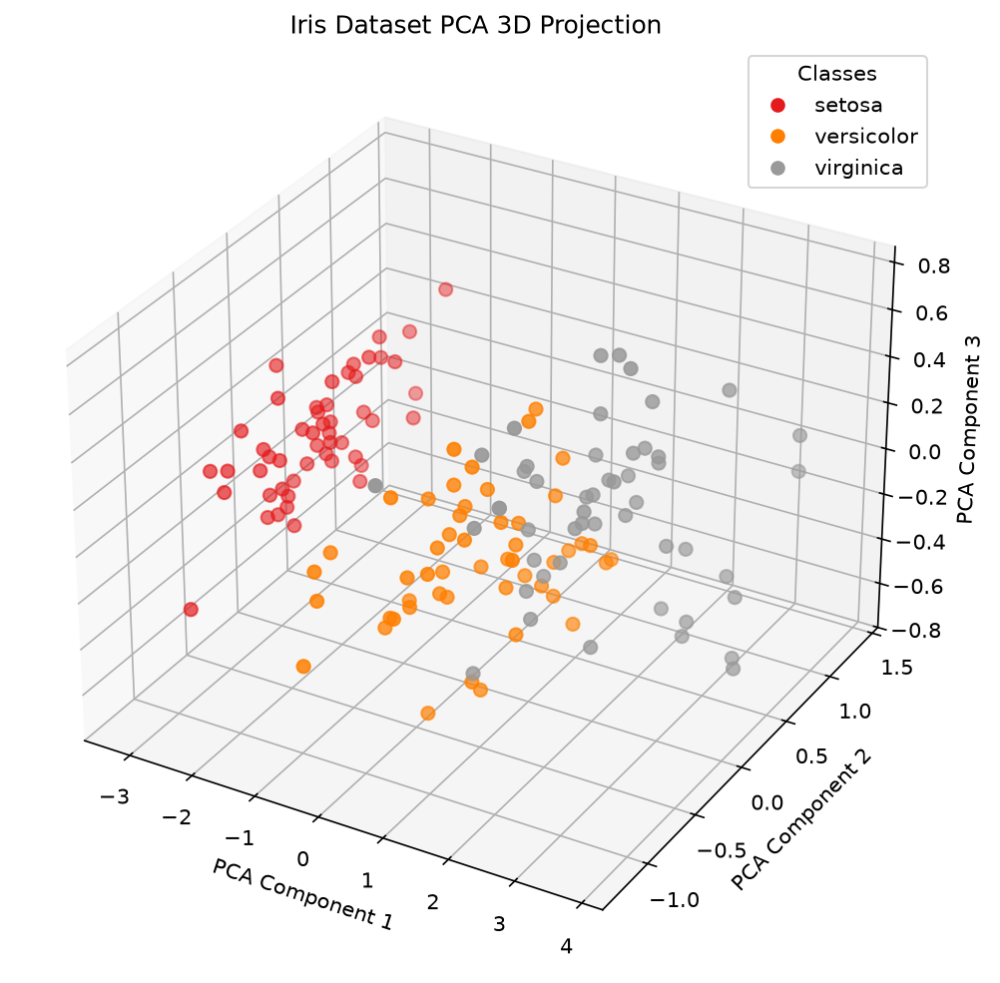
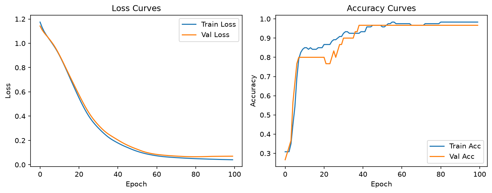

# Iris Dataset Analysis & Neural Network Classification Report

## 1. Introduction

This project performs exploratory data analysis and neural network classification on the Iris dataset.

## 2. Dataset Description

- **Samples:** 150 iris flowers

- **Features:** sepal length, sepal width, petal length, petal width (cm)

- **Classes:** setosa, versicolor, virginica

## 3. PCA Analysis

- PCA reduced 4 dimensions to 3 components, explaining [0.92461872 0.05306648 0.01710261]

## 4. Neural Network Model

- Architecture: Input(4) -> Hidden1(16, ReLU) -> Hidden2(8, ReLU) -> Output(3)

- Optimizer: Adam (lr=0.01)

- Epochs: 100

- Final Test Accuracy: 0.9667

## 5. Conclusion

- The neural network achieves reasonable classification accuracy on the Iris dataset.

- PCA visualization shows clear separation between the three iris species.

- Further work could include hyperparameter tuning, deeper architectures, or other datasets.
